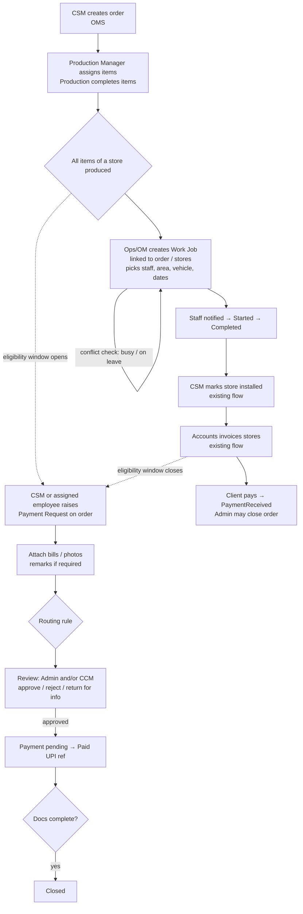

# Discovery: Work Allocation Portal & Payment Request Portal

Phase 1 deliverable for the three-portal brief: existing-system audit, workbook analysis, gap analysis, proposed design and open questions. **No code has been changed.**

Labels used throughout:
- **[Confirmed]**: read directly from the source code or the workbooks.
- **[Proposed]**: my recommendation. Not built, and not final until the related question is answered.
- **[Open]**: needs a business decision. These are numbered and listed in section 7.

---

## Decisions log

| # | Question | Decision (2026-10-20) | Design consequence |
|---|---|---|---|
| 1 | How field staff access the system | **Everyone gets a login** | Pasters, Helpers and Drivers become `User` rows with new `Role` values `PASTER`, `HELPER`, `DRIVER` (Sub-Paster still open, #21). No separate `Employee` table. Field data (`emp_code`, field role, active flag) goes on `User` or a 1:1 `FieldProfile`. User creation must be opened up: Operation Manager may create and deactivate **field-role users only**, while other roles stay super-admin-only. A mobile-first portal is needed for these roles. |
| 2 | Must jobs link to an order? | **Always required** | `WorkJob.order_id` is NOT NULL. **New issue:** creating an order today needs at least one store with at least one line item (`createOrderSchema`). Recces, rectifications and events (most of the historical log) would each need a full order first. See new question 2a. |
| 3 | Who allocates | **Operation Manager writes allocation only** | Add an allow-list exception to `denyReadOnlyMutations` for the allocation, field-staff, leave and OT routes. OM stays read-only for orders and billing. |
| 5 | What a payment request is | **Company pays the requester** (UPI, money out) | Vocabulary: *Paid / Disbursed*, never "Payment received". Kept apart from `Invoice` and order revenue in every report. |
| 2a | Work with no billable order | **Stays outside the portal** | No service-order type. The portal allocates only order-linked jobs; recces and similar work keep their current handling. |
| 6 / 7 | Eligibility window | **Confirmed.** "Building" = installation. Requests open once production is finished and close to *new* requests once billing starts. | Implemented as one pure function `paymentEligibility(order)` on top of `order-stage.ts`. |
| 11 | Multiple requests per order | **Allowed, no cap.** Warn only. | Reviewers see the order's total requested and paid so far, with a warning when it passes the order value. Duplicate submissions are still blocked (idempotency key). |
| 13 | What the "remarks" toggle means | It is a **"Bill details required?" Yes/No** choice made by the requester (CSM or Paster/Helper/Driver) after entering the request details. | Field renamed `bill_details_required`. **Yes** → bill/photo uploads are mandatory. **No** → no bill needed. |
| 14 | Approval routing | **No bill → Admin approves, then Cost Control Manager. Bill → straight to Cost Control Manager.** | Two explicit routes in `payment-workflow.ts` (below). The route is fixed at submission and recorded on the request. |
| 16 / 17 | Who marks paid and closes | **Cost Control Manager** | Only CCM can record payment (UTR/reference) and close. |
| 31 | Notifications | **WhatsApp for the whole project**, via **AskEva** (the company's existing WhatsApp API provider) | WhatsApp becomes a notification channel next to in-app and email, covering existing OMS events as well as the new portals. See §6.3. |

**Payment request routes (decided):**

```
Route A, bill_details_required = No:
  SUBMITTED → ADMIN_REVIEW → (approve) → CCM_REVIEW → (approve) → PAYMENT_PENDING → PAID → CLOSED
                     ↘ reject → REJECTED          ↘ reject → REJECTED

Route B, bill_details_required = Yes:
  SUBMITTED → CCM_REVIEW → (approve) → PAYMENT_PENDING → PAID → CLOSED
                     ↘ reject → REJECTED
  Closing requires the bill/photos to be attached.
```

Still open on this flow: whether Admin and CCM can **return a request for more information** (proposed: yes, back to the requester, who resubmits into the same stage), and whether a requester may cancel before review starts (proposed: yes).

**Phase C defaults (work jobs, built 2026-10-20; change any of these on request):**

| Topic | Default used |
|---|---|
| Job number | `W` + 5 digits from a database sequence (`W00001`). |
| Team size | Up to 2 Pasters, 2 Helpers and 1 Driver per job; at least one person. |
| Length | Whole days, start to end inclusive, at most 62 days. |
| Double-booking | Refused when anyone on the team already has a job on an overlapping day. Enforced twice: a readable 409 from the API, and a Postgres exclusion constraint so two managers saving at once cannot both win. |
| "Allow 2nd job" | A job with this ticked **does not block anyone's calendar** at all, so it never clashes with other jobs. |
| Statuses | Assigned → Started → Completed, with Hold in between. Completed can be reopened (back to Started). Cancelled is final, needs a reason, and frees the team's dates. Only Assigned / Started / Hold jobs can be edited. |
| CSM code | Defaults to the code linked to whoever raised the order; a second code is optional. |
| Grid label | `<CSM code or order no>[/<2nd code>]`, then `-N_<tag>` for non-local or `-<tag>` for local (e.g. `RK/SK-N_CN`, `RK-CN`, plain `RK-N` with no tag). Local / non-local is copied from the area when the job is saved. |
| What field staff see | Their own jobs only, from two weeks back: order no and client name (no amounts or order status), work, dates, area and route, stores, team with phone numbers, vehicle, instructions, and the CSM's name and phone. |
| Notifications | In-app now; WhatsApp mirrors these from Phase G2 (log-only until AskEva is live). The team hears about assignment, removal and cancellation. The CSM hears about start, completion, hold and cancellation. |
| Orders with jobs | Can no longer be deleted; the API explains that the jobs must go first. |

**CSM codes (decided 2026-10-20):** codes such as `300` are the CSMs' employee codes (e.g. Bablu Goud = 300). They live in the database, not in config. Admin or Operation Manager links each one to its CSM under Allocation Masters → CSM codes. The letter codes (`NSG`, `NNG`, `NMG`, `SBDB`, `SBDC`, `SBDG`, `SBDV`) look like team or branch codes and can be marked as such there.

**Phase D defaults (leave and overtime, built 2026-10-20; change any of these on request):**

| Topic | Default used |
|---|---|
| Who records | Admin or Operation Manager records leave and logs overtime. Field staff see their own on My Work. |
| Leave vs jobs | Leave is a **hard block**: nobody on leave can be put on a job, and "Allow 2nd job" does not override it. Recording leave over jobs someone is already on asks first; "save anyway" keeps them on the jobs and flags them on the Daily Board. Editing such a job keeps working unless its dates change. |
| Leave records | Whole days, at most 120 per record; one person's live leave never overlaps (database constraint). Cancelling needs a reason and keeps the record for history. The person is told when leave is recorded, changed or cancelled. |
| Board and grid | People on leave are left out of the free counts; the board lists them, and the grid shows a red "Leave" cell. |
| Overtime entry | One entry per person; the form can log the same hours for up to 5 people at once. Hours come from start and close (24-hour); a close at or before the start runs past midnight (20:00–01:30 = 5h 30m). Same start and close is refused. |
| Overtime rules | Actual clock hours only. The old sheet's rules ("Day 5 hours", "Night 12 hours", "Full day OT") are not applied yet (open question #26). |
| Overtime checks | No overlapping overtime for one person (database constraint, including across midnight); none on a leave day; if linked to a job, the person must be on it, and the CSM code defaults to the job's. |
| Approval | **Admin only** approves or rejects, singly or in bulk; rejecting needs a reason. Only pending entries can be edited or deleted. The person is told the decision. |

**Phase E defaults (field staff start / complete, built 2026-10-20; change any of these on request):**

| Topic | Default used |
|---|---|
| Who | Anyone on the job's team (Paster, Helper or Driver) can mark it started or completed from My Work. Someone not on the job gets "not found". |
| Start | Only an Assigned job, and only from its start date (India time). |
| Complete | Only a Started job, with an optional note (up to 500 characters). |
| Not for field staff | Hold, cancel and reopen stay with Admin and Operation Manager. |
| Recorded | Who started and who completed the job, with the times and note; a manager reopening a completed job clears the completion. Every change is in the audit log under the person who made it. |
| Notified | The CSM and whoever assigned the job (not the person who tapped the button). WhatsApp mirrors it from Phase G2. |
| Photos / proof | Not yet: uploads arrive in Phase G. |

**Phase F defaults (payment requests core, built 2026-10-20; change any of these on request):**

| Topic | Default used |
|---|---|
| Who raises | A CSM on orders they created; a Paster, Helper or Driver on orders where they are on a live (not cancelled) job. Admin, Operation Manager, Cost Control and Accounts do not raise requests. |
| Who sees | A requester sees only their own requests. The Admin and the Cost Control Manager see all of them. The Operation Manager has no access. |
| Eligibility (#6–#9) | Open once every item sent to production is produced, or the order is Installed. An order with nothing sent to production is open. Closed to new requests from the first invoice on any store (not only the "billing started" statuses, since a part-billed order can still read Installed). Requests already raised carry on after billing. |
| Request | Amount (₹, up to 2 decimals), UPI ID (name@bank, stored lower-case), what it is for, optional category (Travel, Material, Labour, Food, Advance, Other), optional remarks, optional field job on that order, and "Bill details required?" Yes/No. The requester is the payee. |
| Number | `PR-YYMM-NNNN` (month in India time); the running number does not reset monthly. |
| Routes | As decided: No bill → Admin review → Cost Control review; Bill → Cost Control review. The route is fixed at submission. |
| Return for info | Yes. Either reviewer can return a request with a reason; the requester corrects amount, UPI ID, purpose, category or remarks (not the bill choice) and it goes back to the same stage. Changes are written into the history. |
| Reject | Either reviewer, at their own stage, with a reason. Final. |
| Cancel | The requester can withdraw while it waits at its first review stage or is returned to them. The Admin can cancel any request that is not yet paid, with a reason. |
| Mark paid | Cost Control only, from Payment pending. UTR/reference is mandatory; the amount paid defaults to the amount asked and cannot exceed it. |
| Close | Cost Control only, once paid. The "bill must be attached" check arrives with uploads in Phase G. |
| Amount cap (#11, #19) | None. Reviewers see the order's value, total asked (live requests) and total paid out, with a red warning when asked exceeds the order value. The requester gets the same warning on submit. |
| Duplicates | Each form carries a one-time key; a double submit returns the first request. |
| Concurrency | Every action checks the status it was read in, so two reviewers acting at once cannot both succeed. |
| History | Every step is an append-only event (who, role, from → to, note); the database refuses edits to it. Request rows are also in the audit log. |
| Orders and users | An order with payment requests cannot be deleted; a user with payment or work history cannot be deleted (deactivate instead). Closing a request never changes the order. |
| Notified (in-app) | New and resubmitted requests → the reviewers for that stage; Admin approval → Cost Control and the requester; Cost Control approval, rejection, return, cancellation and payment → the requester; withdrawal → that stage's reviewers. WhatsApp mirrors these from Phase G2. |
| Overdue timers | Not yet (Phase H). Each request records when it entered its current status, and queues list the oldest first. |

**Phase G defaults (bills, photos and receipts, built 2026-10-20; change any of these on request):**

| Topic | Default used |
|---|---|
| Storage (#27) | Files are stored in Postgres (a separate blob table, so lists never load file bytes). The API runs on Render, whose disk is wiped on restart, and no R2 bucket or keys exist yet. Storage sits behind one interface, and each file records which store holds it, so Cloudflare R2 can take over new uploads once keys are provided without moving old files. |
| Types and size (#27) | JPG, PNG, WEBP, HEIC photos and PDF, up to 5 MB each. The type is read from the file's first bytes, not its name: a renamed program is refused, and a JPEG named `.pdf` is stored as a JPEG. |
| Phone photos | Large JPG, PNG and WEBP photos are scaled to 1600 px on the long side and saved as JPEG in the browser before upload. HEIC and PDF go as they are. |
| Kinds | Bill, Photo, and Payment receipt (Cost Control only). |
| Who adds | The requester adds bills and photos to their own request; the Admin can add bills and photos; Cost Control can add all three. Nothing is added once a request is closed, rejected or cancelled. Files can be attached while raising the request or later. |
| Who removes | Whoever added the file, or the Admin or Cost Control, while the request is open. Removal is a soft delete: the file stays in the database and the history. |
| Limits | Up to 10 live files per request. The same file cannot be attached twice to one request (enforced in the database, safe under double clicks). |
| Mandatory (#28) | A request raised with bill details cannot be closed until a bill is attached (a receipt does not count). Photos are optional. A "Bill missing" flag shows on open requests in every list. |
| Who sees | Anyone who can see the request can view and download its files; requests stay private to their requester, the Admin and Cost Control. |
| History | Adding and removing a file are recorded in the request's history and the audit log. |

**Phase G2 defaults (WhatsApp via AskEva, built 2026-10-20 in log-only mode; change any of these on request):**

| Topic | Default used |
|---|---|
| Switched off for now | `WHATSAPP_MODE=log` (the default) records every message and prints it to the server log, but sends nothing. Setting `WHATSAPP_MODE=live` sends only when `ASKEVA_TOKEN` is also set. Admin → WhatsApp shows which mode is on. |
| AskEva API | AskEva's own API pages are offline (404). The adapter follows a published AskEva client: `POST https://backend.askeva.io/v1/message/send-message?token=…` with Meta's template body. All AskEva-specific code is in one file (`services/whatsapp/askeva.ts`). To confirm with AskEva before going live: the token placement, the reply format (the message id), the status-webhook format and signing, and rate limits. |
| Never blocks work | Payment messages are written in the same transaction as the change (no change, no message). Job and order messages are written straight after the change, and a WhatsApp problem there is logged, never shown to the user. A background sender (every 10 s, 20 at a time) delivers them. |
| Retries | AskEva busy or down (timeout, 429, 5xx): retried after 1, 5, 15 and 60 minutes, then marked Failed. Refused (other 4xx, e.g. template not approved, bad number): Failed at once with AskEva's reason. Admin can "Send again" from the log. |
| Events covered | Field staff: job assigned, removed, cancelled. CSM: team assigned, job started, on hold, completed, cancelled; the job's creator also hears about start/complete by field staff. Payments: new or resubmitted request → that stage's reviewers; Admin approval → Cost Control and the requester; approved / rejected / returned / cancelled / paid (with reference) → the requester; withdrawn → the reviewers. Orders (to whoever raised the order): production complete, invoice raised, payment received. These mirror the in-app notifications. Not yet: leave and overtime messages, daily summaries and "pending > 10 days" (Phase H). |
| Templates | 9 Utility templates in English (`sbd_job_assigned`, `sbd_job_removed`, `sbd_job_cancelled`, `sbd_job_update`, `sbd_payment_to_review`, `sbd_payment_withdrawn`, `sbd_payment_update`, `sbd_payment_paid`, `sbd_order_update`). Exact text with copy buttons is on Admin → WhatsApp → Templates, ready to submit in AskEva. Every one starts "Hi {{1}}" (first name) and ends with fixed words, as Meta requires. |
| Phone numbers | Users have one mobile number, saved as +91XXXXXXXXXX. 10 digits, or with 0, 91 or +91 in front, are accepted. The Admin (super admin) sets it on Users, field staff on Field Staff, and anyone on their own Profile. People without a valid number still get in-app notifications; their WhatsApp messages are logged as "Not sent: No phone number", and "Send again" after adding the number delivers them. |
| Opt-out | A "WhatsApp messages" switch on each profile (and on the Admin's user editor). Replying STOP / UNSUBSCRIBE on WhatsApp turns it off; START turns it back on. Messages to someone opted out are logged as "Not sent: Opted out". |
| Delivery reports | `GET/POST /api/webhooks/askeva`. The handshake uses `ASKEVA_WEBHOOK_SECRET` as the verify token; every report must carry `?key=<same secret>`. Reports can only move a message forward (Sent → Delivered → Read; Failed only from Sent/Delivered). Without the secret the webhook answers 503 and messages stop at Sent. |
| Who sees the log | Admin only (Admin → WhatsApp): delivery log with status filters and search, the template texts, and who has no number. The Operation Manager sees a notice. |
| Privacy | The AskEva token never appears in the log or errors; the server log shows numbers masked (+91…3210). |

Not in Phase C, still to come: a CSM's view of the jobs on their orders, Started / Completed buttons for field staff (Phase E), and checking the grid against the WB2 9–15 Oct sample once real jobs are entered.

---

## 0. Headline findings

These change the design more than anything else in this document.

1. **Neither workbook contains an order number.** [Confirmed] A job is identified by CSM code + free-text work description + area. Nothing ties a job to `ORD26xxxx`, so linking allocations to OMS orders is a **new rule**, not something the spreadsheets already do. Much of the logged work also doesn't look like a billed order: recces, rectifications, events, in-office printing.
2. **The CSM codes are unresolved, even inside workbook 2.** [Confirmed] Codes `033 055 088 300 400 500 599 600 700 800 900 NSG NNG NMG SBDB SBDC SBDG SBDV` are listed with blank names. The workbook's own "STILL TO CONFIRM" section asks whether `088 / NSG / NNG / SBDx` are CSMs, branches or in-house teams. The OMS knows CSMs only as `User` rows with role `CSM`.
3. **Workbook 2 is a redesign of workbook 1, not a peer.** [Confirmed] It imports workbook 1's grid (9–15 Oct → 180 Task Log rows), OT, leave, Work Details ("Old Work Details") and Master ("Staff Master (old)"). Workbook 1 has grid entries up to 23 Oct, so it is still the **live** sheet. Workbook 2 was never switched on: CSM names and phone numbers are blank, the web-app URL is empty, the Notification Log is empty, and all 180 rows are still `Assigned / Sent`.
4. **Workbook 2 depends on a Google Apps Script that isn't in the file.** [Confirmed] The double-booking *block*, alerts, "My Work" links and scheduled summaries live in `Code.gs` / `MyWork.html`, which weren't provided. The xlsx only *flags* conflicts with a formula.
5. **Operation Manager is view-only in the app today.** [Confirmed] `denyReadOnlyMutations` rejects every non-GET request from `OPERATION_MANAGER`. The brief makes this role assign work and register employees.
6. **"Payment" already means money coming in.** [Confirmed] `OrderStatus.PaymentReceived`, `Invoice.amount_received` and `PaymentFollowUp` all track the **client paying the company**. A payment request paid to a UPI ID is money going **out** to the requester. The two need separate vocabulary (for example *Paid / Disbursed* rather than "Payment received"), or dashboards will mix them up.
7. **There is no file-upload infrastructure.** [Confirmed] `User.photo_url` is a pasted URL, and the only binary upload is the super-admin xlsx import. The API runs on Render, whose disk is wiped on every deploy, so bill photos need object storage.
8. **Field staff don't have app accounts.** [Confirmed] About 40 pasters, helpers and drivers exist only in the spreadsheets. Workbook 2 gives them a secret "My Work" link instead of a login.

---

## 1. Existing application [Confirmed]

| Area | What exists |
|---|---|
| Repo | npm workspaces: `apps/api`, `apps/web`, `packages/shared-types` |
| Backend | Express 4, Prisma 5, PostgreSQL (Neon), zod validators, JWT in an httpOnly cookie, helmet, express-rate-limit, nodemailer |
| Frontend | React + Vite, TanStack Router file routes (`_portal.<role>.*`), shadcn/ui |
| Hosting | Web on a Cloudflare Worker (static assets + `/api` proxy) → API on Render (`saibalajidigitals.onrender.com`) |
| Migrations | Prisma migrations, **applied by hand on production** (not run on deploy) |
| Roles (`Role` enum) | `ADMIN` (+ `is_super_admin` flag), `OPERATION_MANAGER` (read-only), `CSM`, `ACCOUNTS`, `PRODUCTION`, `PRODUCTION_MANAGER` |
| AuthZ | `authenticate` re-reads the user from the DB on every request; `authorize(...roles)` per route; `requireSuperAdmin` for user create/edit/password reset; `denyReadOnlyMutations` for Operation Manager |
| Users | Only the super admin can create users (`POST /api/users`) |

**Order data model**

- `Order`: `order_no` (unique, from `OrderSequence`), `client_name` (**free text**, not a foreign key), job-level PO, `status` (**derived**), creator.
- `OrderStore`: one row per physical store. It carries its own `installed_at` / `installed_by`, PO and `invoice_id`.
- `OrderItem`: media, size, qty, sft, rate, amount, loss remarks + confirmation, flags, `production_completed`.
- `OrderItemAssignment`: links an item to a `PRODUCTION` user. An item counts as complete once every assignment on it is complete.
- `Invoice`: one per group of stores, holding bill amount, billing date, amount received and when.
- `PaymentFollowUp` (notes chasing the client), `OrderChangeLog`, `AuditLog` (DB triggers, attributed via `app.current_user_id`), `Notification` (in-app), and the `Client` / `Media` lookup lists.

**Order lifecycle.** Status is derived in `utils/order-derive.ts`; stages come from `utils/order-stage.ts`.

| Status | Meaning | Stage shown |
|---|---|---|
| `Active` | Production running, or produced but not every store installed | In production → **Awaiting installation** |
| `Installed` | Every store installed, not every store invoiced | Awaiting billing |
| `BillingCompleted` | Fully invoiced, unpaid | Awaiting payment |
| `Pending` | Billed short or part-paid | Pending (billing / payment) |
| `PaymentReceived` | Client paid in full | (closed) |
| `Completed` | Admin closed / force-closed | (closed) |

- Production completion is tracked per **item** (`production_completed_at`).
- Installation is tracked per **store** (`installed_at`). The CSM or admin marks it, and only once that store's items are produced.
- Billing completion is tracked per **invoice**.
- These events are already distinct, as the brief requires.

**Overdue today.** `GET /api/admin/overdue` counts **business days, excluding Sundays** in the current stage, with a default threshold of 5.

---

## 2. Workbook analysis [Confirmed]

### 2.1 `Work Allocation Sheet.xlsx`: the current manual process (6 sheets)

| Sheet | Purpose | Columns | Logic |
|---|---|---|---|
| **WAS** | Weekly person × day grid, 9–23 Oct 2026 | S.No, Person Name, Designation, one column per date | Only formula: `S.No = previous + 1`. No validation and no conditional formatting; colours are filled by hand. Three blocks: **Paster** (25), **Ast. Paster** (12), **Driver** (4). |
| | | | A cell is free text: CSM code(s) like `600`, `088/NSG`, `700/599/400`. Suffixes: `-N` (Non-Local), `-CN`, `_N8`. Also `Leave` and `Servicing` (vehicle). Typos are common (`59/6009-N`, `'088`). |
| | | | Footer notes (operational SOP): share the WAS picture at 9:30 am (Admin group), 3 pm (CSMs + Leaves group) and 7 pm (all); parcels dispatch at 6 pm; at 12 pm cross-check each CSM's daily sheet against the WAS. |
| **Work Detailes** | Job log, 639 rows, 29 Jul – 8 Sep | Date, CSM Name, Work Details, Employees, Remarks, Status | Free text throughout. CSM is a **first name** (Bablu, Swathi, Ravikishore, Shiva, Naresh, Sunil, Praveen, Nagesh, Rahul), not a code. Employees look like `"A & B"`, with 126 distinct spellings, plus entries like "SBDV Team", "Sub Vender Gopi" and "Hold". Remarks is usually the completion date, sometimes a range ("24/08 To 31/08"). Status is `Completed` 618 or `Hold` 20, with inconsistent case and spacing. |
| **OT - AS** | Overtime register, 522 rows | Date, Paster/Driver, Helper ("No" = none), Start, Close, CSM (code), Remarks | Times are typed inconsistently (fractions vs times). An unlabelled column holds OT rules: "Day Time 5 Hours", "Night Time 12 Hours", "Give Full Day OT", "Without Information". |
| **Vehicle Routes** | Driver trips | Person, Auto Number, From, Return, Route, CSM Work | Header plus 4 driver names. **Never used.** |
| **Leave Details** | Leave | Employee, From, To, Days, Remarks | 7 rows. Days is typed text ("37 Days"), not calculated. |
| **Master** | Company-wide staff list, 99 rows | S.No, Code (105–402), Name, Designation | Paster 25, Ast. Paster 21, Operator 9, CSM 9, Production 7, Accountant 6, Administration 4, Designer 4, Driver 4, Purchase 3, Welder 3, Delivery 2, Marketing 1, Fabricator 1 |

### 2.2 `SBD_Smart_Work_Allocation.xlsx`: proposed redesign (19 sheets, Google Sheets + Apps Script)

Its stated principle: *enter each job once; the grid, dashboards and messages update themselves.*

**Process it describes (Start Here sheet):**
1. The CSM asks for people.
2. The Ops Manager checks the Daily Board for free staff.
3. The Ops Manager adds a Task Log row, picking an area, which sets Local/NL.
4. A conflict (already busy or on leave) is rejected unless "Allow 2nd job = Yes".
5. Setting Alert = Send messages the staff and the CSM(s).
6. The grid updates itself.
7. Staff tap Started / Completed on their My Work link, and the CSM is told.

**Data-entry sheets:**

| Sheet | Columns | Validation / logic |
|---|---|---|
| **Task Log**: the only place jobs are entered. One row = one job/team; 180 rows so far. | Job ID (`W0001`), Start Date, End Date (only if multi-day), Days*, CSM Code, CSM 2, CSM Name(s)*, Work Details, Area Name, Local/NL, Paster 1, Paster 2, Helper 1, Helper 2, Driver, Vehicle No, Route (From → To), Extra Tag, Allow 2nd job, Instructions/Remarks, Status, Alert, Alert Sent At, Completed On, ⚠ Check*, plus 7 helper columns* | **End ≥ Start** (custom rule, error text "End Date cannot be before Start Date"). Dropdowns: CSM codes (CSMs), people (Employees), Area (Areas), Local/NL, Vehicle, Extra Tag (`CN`, `N8`), Yes, **Status** `Assigned / Started / Completed / Hold / Cancelled`, **Alert** `Send / Sent / Don't send`. |
| | | **⚠ Check** formula, per person in the row, skipped when Completed or Cancelled: end before start; area not in the master; **on leave in the date range** (unless Allow 2nd job); **already in another non-cancelled job overlapping the range** (unless Allow 2nd job); same person twice in the row. A non-empty check turns the row red. |
| **OT Register** | Date, Paster/Driver, Helper, Start, Close, Hours*, CSM Code, CSM Name*, Work/Remarks, **Approved By** | `Hours = MOD(close − start, 1) × 24`, which handles OT past midnight. Approved By is new and empty in all 522 rows. |
| **Leave** | Employee, From, To (blank = one day), Days*, Reason | Leave blocks new work and shows on the grid. |

\* = calculated

**Master sheets:**

| Sheet | Contents |
|---|---|
| **Employees** (field team only, 40 rows) | Emp Code (only 20 filled), Name *as used daily* (the join key everywhere), Full Name, **Role ∈ {Paster, Helper, Driver}** (24 / 12 / 4), WhatsApp, Email, Telegram, Old spelling 1/2, Active? (Yes/No hides the person but keeps history), Link Code, My Work link. *"Ast. Paster" from workbook 1 became "Helper".* |
| **CSMs** | 18 codes. Name, WhatsApp, Email, Telegram and link code are **all blank**. Headed "Claim Service Managers", while the OMS says "Client Service Manager". |
| **Areas** | 113 areas: 52 Local (Hyderabad city), 61 NL. 7 are marked "please confirm" (Medchal, Shamshabad, Pocharam…). |
| **Vehicles** | 4 placeholders `VEHICLE-1..4` with a usual driver. Today's driver, route, CSM and work are derived from the Task Log. |
| **Settings** | Admin email, web-app URL, channels (Email ON, Telegram OFF, WhatsApp Cloud API OFF, WhatsApp click-links ON), schedule (evening plan 19:00, CSM summary 15:00, admin summary 09:00), notify CSM on status change ON, remind idle staff OFF |
| **Lists** (hidden) | Dropdown sources: Status, Alert, Extra Tag, Role, Area Type |

**Read-only views (all formulas):**

| Sheet | Shows |
|---|---|
| **WAS** | 7-day grid starting yesterday. A cell is `Leave`, or each overlapping job as `CSM[/CSM2][-N][_tag]` joined by ` + `. Colours: free = green, leave = red, double-booked (`+`) = yellow, helper and driver rows tinted. Footer counts free pasters per day. |
| **Daily Board** | For one date: job count, free pasters, helpers and drivers **with phone numbers**, who's on leave, who's busy, and every job that day |
| **Find Work** | Filter by date range, employee, CSM, area contains, Local/NL, status → KPIs (jobs, people, person-days, NL jobs, completed, pending, on hold, vehicle trips), a people list and a job list |
| **Employee Dashboard** | One person over a range: jobs, completed, pending, NL, OT count and hours, leave days, today's status, role on each job, and old history matched by old spellings |
| **CSM Dashboard** | One CSM code over a date or range: pasters / helpers / drivers / vehicles with phones, status counts, job list |
| **Vehicle Routes** | Jobs with a driver or vehicle in a range: trips, driver-days, NL trips, completed |

**History and logs:**
- **Old Work Details**: copy of workbook 1's Work Detailes.
- **Staff Master (old)**: copy of workbook 1's Master.
- **Notification Log**: Time, Job ID, To, Role, Channel, Result, Message, WhatsApp link. Empty.

**Internal inconsistencies:**
- Start Here says Local/NL fills itself from the Area, but the Task Log makes it a manual dropdown (presumably the missing script fills it).
- Converted rows have Local/NL filled but no Area.

### 2.3 Workbook comparison

| Topic | Workbook 1 (live) | Workbook 2 (redesign) | Recommended source of truth |
|---|---|---|---|
| Job record | A grid cell per person per day, plus a separate free-text Work Details log | One Task Log row per job, multi-day by start/end; grid derived | **WB2 model** → a `WorkJob` table |
| Team per job | Free-text "A & B" | Fixed slots: 2 Pasters, 2 Helpers, 1 Driver | WB2, but as a member list rather than fixed columns [Open #20] |
| CSM identity | First names (log), codes (grid, OT) | Codes only, names unknown | **OMS `User` (role CSM)**, once codes are mapped [Open #4] |
| Field roles | Paster / Ast. Paster / Driver | Paster / Helper / Driver | WB2 vocabulary; Sub-Paster status [Open #21] |
| Staff master | 99 company-wide, codes 105–402 | 40 field staff, codes half-filled | WB2 Employees + WB1 codes merged |
| Location | Embedded in work text | Area master + Local/NL | WB2 Areas |
| Leave | 7 rows, typed day counts | Register, blocks allocation | WB2 |
| Overtime | Inconsistent times, rules in a stray column | Hours calculated, Approved By | WB2 + OT rules [Open #26] |
| Vehicles | Unused sheet | Master + daily derivation | WB2 (needs real plates) |
| Status | Completed / Hold | Assigned / Started / Completed / Hold / Cancelled | WB2 |
| Double-booking | None | Flagged by formula, blocked by script, override flag | WB2, **enforced in the backend** |
| Staff self-service | None (WhatsApp photos of the grid) | My Work link: Started / Completed | WB2 idea, delivery method [Open #1] |
| Notifications | Manual WhatsApp at 9:30 / 15:00 / 19:00 | Email / Telegram / WhatsApp, scheduled | In-app + email first; WhatsApp later [Open #31] |
| Order link | None | None | **New**, see [Open #2] |
| Payment / expenses | None | None | **Entirely new.** The workbooks give no guidance on payment requests. |

**Spreadsheet behaviour worth reproducing:**
- Single entry with derived views (grid, Daily Board, dashboards, Find Work).
- Overlap and leave conflict checks with an explicit override.
- Multi-day jobs.
- Area → Local/NL, shown as `-N`.
- Active/inactive staff that keep their history.
- OT hours across midnight.
- Phone numbers on the boards.
- Status colours.

**Spreadsheet behaviour to drop:** grid cell syntax, helper ⚙ columns, old-spelling matching (replace with a one-time data clean-up), fixed row limits, link codes acting as passwords.

---

## 3. Current app vs expanded scope (gap analysis)

| Capability | Today | Gap |
|---|---|---|
| Orders, stores, items, invoices, derived status | ✅ | Keep. Only additive changes. |
| Production assignment | ✅ items → `PRODUCTION` users | This is *factory* production. Field allocation is a separate concept and must not reuse `OrderItemAssignment`. |
| Installation | ✅ per store, marked by CSM/Admin | Field staff do the installing, but the CSM marks it. Should a completed job mark the store installed? [Open #23] |
| Field staff (Paster/Helper/Driver) | ❌ | New entity, plus access method [Open #1] |
| Cost Control Manager | ❌ | New role |
| Operation Manager writes | ❌ read-only by design | Scoped write access [Open #3] |
| CSM codes | ❌ | Mapping table or a column on `User` [Open #4] |
| Areas, vehicles, leave, OT | ❌ | New tables |
| Work jobs + conflict rules + boards | ❌ | New module |
| Payment requests, approval, history | ❌ | New module |
| File uploads | ❌ | Object storage plus a new upload API |
| Notifications | ✅ in-app + email | Add a WhatsApp channel (AskEva) for every event, old and new; phone numbers become required for users who receive them |
| Audit | ✅ triggers + change log | Add triggers to the new tables, plus an explicit event table for payment requests |
| Overdue | ✅ order stage, business days | New per-condition timers for payment requests |

---

## 4. Proposed end-to-end workflow [Proposed]



Separation rules:
- Closing a payment request never changes order status.
- A work job completing never changes order status, unless #23 decides otherwise.
- Billing never closes an open payment request. It only stops *new* ones.

**Proposed eligibility window (mapped onto the existing model, [Open #6–#9]):**
- **Opens** when production is complete, meaning stage "Awaiting installation" (`Active` with every assigned item produced) or status `Installed`.
- **Closes** for *new* requests once billing starts (`BillingCompleted`, `Pending`, `PaymentReceived`, `Completed`, which matches the existing `isBillingStarted()` helper).
- Orders with **no production assignment** need a rule.
- "Building" does not exist in the app: is it a separate stage, or another word for installation?

---

## 5. Role-permission matrix [Proposed]

✅ allowed · 👁 read · ⚪ own records only · ❌ denied · ❓ open question

| Capability | Admin | Op. Manager | CSM | Cost Control Mgr | Accounts | Prod. Mgr | Paster / Helper / Driver |
|---|---|---|---|---|---|---|---|
| Existing order actions | ✅ | 👁 | ⚪ (as today) | 👁 order + client | as today | as today | ❌ |
| Register / deactivate field staff | ✅ | ✅ ❓#3 | ❌ | ❌ | ❌ | ❌ | ❌ |
| Areas / vehicles masters | ✅ | ✅ | ❌ | ❌ | ❌ | ❌ | ❌ |
| Create / edit work jobs, assign staff | ✅ | ✅ ❓#3 | request only ❓#23 | ❌ | ❌ | ❌ | ❌ |
| Override double-booking | ✅ | ✅ | ❌ | ❌ | ❌ | ❌ | ❌ |
| View allocation boards / grid | ✅ | ✅ | 👁 own CSM code | ❌ | ❌ | 👁 ❓ | ⚪ own jobs |
| Mark job Started / Completed | ✅ | ✅ | ❌ | ❌ | ❌ | ❌ | ⚪ ❓#1 |
| Leave register | ✅ | ✅ | ❌ | ❌ | ❌ | ❌ | ⚪ view |
| OT entry / approval | ✅ / ✅ | ✅ / ❓ | ❌ | ❌ | ❓ | ❌ | ⚪ view |
| Raise payment request | ❓ | ❓ | ⚪ own orders | ❌ | ❌ | ❌ | ⚪ assigned orders ❓#22 |
| Set "remarks required" | ✅ | ❌ | ✅ | ❌ | ❌ | ❌ | ❌ |
| Upload bills / photos | ✅ | ❌ | ⚪ | ✅ routed | ❌ | ❌ | ⚪ own request |
| Approve / reject / return | ❓#13–15 | ❌ | ❌ | ❓#13–15 | ❌ | ❌ | ❌ |
| Mark paid (UPI ref) | ❓ | ❌ | ❌ | ❓ | ❓#16 | ❌ | ❌ |
| Close request | ❓#17 | ❌ | ❌ | ✅ ❓ | ❌ | ❌ | ❌ |
| See UPI IDs / amounts | ✅ | 👁 ❓ | ⚪ | ✅ routed | ❓ | ❌ | ⚪ own |

Enforcement: every cell is a backend check (`authorize` + row-level ownership in the controller), not just a hidden button. Operation Manager's blanket `denyReadOnlyMutations` would get an explicit allow-list for the work-allocation routes only, so it stays read-only for orders and billing.

---

## 6. Proposed data model & API [Proposed, pending batch-1 answers]

### 6.1 Schema changes

**Additive only.** Existing tables keep their columns, and every migration is hand-applied, following the existing practice.

**Enum changes**
- `Role` gains `COST_CONTROL_MANAGER`. Whether it also gains `FIELD_STAFF` or `PASTER` / `HELPER` / `DRIVER` depends on #1.
- `FieldRole`: `PASTER`, `HELPER`, `DRIVER` (plus `SUB_PASTER`, depending on #21).
- `WorkJobStatus`: `ASSIGNED`, `STARTED`, `COMPLETED`, `HOLD`, `CANCELLED`.
- `PaymentRequestStatus` (decided routes): `SUBMITTED`, `ADMIN_REVIEW`, `CCM_REVIEW`, `INFO_REQUESTED` (if return-for-info is confirmed), `PAYMENT_PENDING`, `PAID`, `CLOSED`, `REJECTED`, `CANCELLED`.

**Field staff and masters**

| Table | Key fields | Notes |
|---|---|---|
| `Employee` | `emp_code?` unique, `display_name` unique, `full_name`, `field_role`, `phone`, `email?`, `is_active`, `user_id?` unique → `User` | Field staff without a login stay rows here. Those who need to log in link to a `User` [#1]. |
| `CsmCode` | `code` unique, `user_id?` → `User`, `label`, `kind` (CSM / team / branch) | Resolves the 18 codes without guessing [#4] |
| `Area` | `name` unique, `locality` (LOCAL / NON_LOCAL), `district?` | Seeded from the 113 areas |
| `Vehicle` | `reg_no` unique, `type`, `usual_driver_id?`, `is_active` | |

**Work allocation**

`WorkJob`
- **Identity:** `job_no` (`W0001`, unique); `order_id?` and `order_store_id?` depending on #2.
- **Dates:** `start_date`, `end_date` (end ≥ start, enforced with a DB CHECK).
- **Ownership:** `csm_code_id`, `csm2_code_id?`.
- **Job details:** `work_details`, `area_id`, `locality` (snapshot), `vehicle_id?`, `route?`, `extra_tag?`, `instructions?`.
- **Status:** `status`, `allow_double_booking`, `started_at?`, `completed_at?`, `cancelled_reason?`.
- **Audit:** `created_by`, timestamps.

`WorkJobMember`
- Fields: `job_id`, `employee_id`, `slot_role`.
- `start_date` and `end_date` are copied from the job.
- Unique on `(job_id, employee_id)`.
- A **Postgres exclusion constraint** (`btree_gist`) prevents overlapping date ranges per employee unless the job allows double booking or is cancelled. The conflict check then holds under concurrent requests, not only in the UI.

`LeaveRecord`
- Fields: `employee_id`, `from`, `to`, `reason`, `created_by`.
- Creating a job checks it against leave; creating leave warns about overlapping jobs.

`OvertimeEntry`
- Fields: `work_date`, `employee_id`, `helper_id?`, `start_time`, `end_time`, `hours` (calculated, crosses midnight), `csm_code_id?`, `work_job_id?`, `remarks`, `approved_by?`, `approved_at?`.

**Payment requests**

`PaymentRequest`
- **Identity:** `request_no` (`PR-2610-0001`, unique, separate from `order_no`).
- **Links:** `order_id` (required), `order_store_id?`, `work_job_id?`.
- **Requester:** `requested_by_user_id`, `payee_employee_id?`.
- **Money:** `amount Decimal(10,2) > 0`, `upi_id` (validated format), `purpose / category?` [#12].
- **Bill details:** `bill_details_required` (bool, chosen by the requester; fixes the route), `remarks?`. Closing a request whose flag is Yes requires at least one BILL attachment (checked in `payment-workflow.ts`).
- **Workflow:** `status`, `route` (which review path applies).
- **Payment:** `paid_amount?`, `paid_at?`, `payment_reference?` (UTR), `paid_by?`.
- **Closure:** `closed_at?`, `closed_by?`.
- **Duplicate prevention:** `idempotency_key` unique.
- **Overdue timers**, one per condition: `approval_pending_since?`, `docs_pending_since?`, `payment_pending_since?`.

Other payment tables:
- `PaymentRequestEvent`: an append-only history row per action (`request_id`, `action`, `from_status`, `to_status`, `actor_id`, `actor_role`, `note`, `created_at`).
- `PaymentAttachment`: `request_id`, `order_id` (copied for lookups), `kind` (BILL / PHOTO / RECEIPT), `storage_key`, `original_name`, `mime`, `size_bytes`, `sha256`, `uploaded_by`, `uploaded_at`, `deleted_at?` (soft delete only).

**Rules in one place.** The payment state machine goes in `utils/payment-workflow.ts`, following the pattern of `order-derive.ts`. Every transition (who may do what, from which status, and what it requires) lives in one table, and every controller calls it. Thresholds (10 days, file limits, max photos) live in a small settings table rather than being hard-coded.

**Uploads.**
- Recommended storage: a private **Cloudflare R2** bucket (S3 API), since the web app already runs on Cloudflare.
- The API checks type by magic bytes (not just the extension), size, and photo count per request.
- Downloads use short-lived signed URLs.
- Alternative: Postgres `bytea`. It's simpler but grows Neon storage. [#27–28]

### 6.2 API outline (new routes, all behind `authenticate`)

| Route | Purpose |
|---|---|
| `/api/employees` | CRUD for field staff, activate/deactivate, link to a user |
| `/api/csm-codes`, `/api/areas`, `/api/vehicles` | Masters |
| `/api/work-jobs` | CRUD with a conflict check that returns structured errors (busy / on leave) and an override flag |
| `/api/work-jobs/board?date=` | Daily Board |
| `/api/work-jobs/grid?from=&days=` | WAS grid |
| `/api/work-jobs/availability` | Free staff |
| `/api/work-jobs/:id/status` | Started / Completed |
| `/api/leave`, `/api/overtime` (+ `/approve`) | Registers |
| `/api/my/work` | Field staff: own jobs and status updates |
| `/api/orders/:id/payment-eligibility` | Window open or closed, with the reason |
| `/api/orders/search?q=` | Order picker for requests and jobs (order + client + stores + assigned staff) |
| `/api/payment-requests` | List (filters, overdue flags) and create |
| `/api/payment-requests/:id/{submit,approve,reject,return,mark-paid,close,cancel}` | Workflow actions, all routed through `payment-workflow.ts` |
| `/api/payment-requests/:id/attachments` | Upload, list, view (signed URL), soft delete |

New web routes:
- `/_portal/ops/*`: allocation boards, jobs, staff, leave and OT.
- `/_portal/payments/*`: requester views.
- `/_portal/cost-control/*`: Cost Control Manager queue and dashboard.
- A mobile-first `/my-work` page for field staff.

---

### 6.3 WhatsApp notifications via AskEva [Decided channel, design Proposed]

**Design**
- **One sending path for everything.** `notifications.service.ts` already writes in-app notifications. It gains a channel layer: in-app (as today), email (as today) and WhatsApp (new). Each event is defined once with its recipients and template, and every channel renders from that.
- **Provider adapter.** All AskEva-specific code sits in `services/whatsapp/askeva.ts` behind a small `sendTemplate(to, templateName, params)` interface, so switching provider later doesn't touch business code.
- **Never block the request.** Messages go into a `NotificationOutbox` table inside the same transaction as the business change. A background worker sends them, with retries and backoff. A WhatsApp outage can't fail an order save or an approval.
- **Delivery log.** Each send stores provider message ID, status (queued / sent / delivered / read / failed), error and timestamps. If AskEva supports delivery webhooks, a `/api/webhooks/askeva` endpoint updates the status, verified by a shared secret. This replaces workbook 2's Notification Log.
- **Recipients.** Every user who should get WhatsApp needs a phone number in E.164 format (for example `+919876543210`), validated on save, plus an opt-out flag per user.
- **Templates.** WhatsApp only allows business-initiated messages through Meta-approved templates, so each event below needs an approved template in AskEva before go-live. I'll draft the template texts.

**Events (first pass, to confirm)**

| Area | Event | Recipients |
|---|---|---|
| OMS | Order created / installed / ready to bill / invoiced / payment received / closed | CSM, Accounts, Admin (matching today's in-app notifications) |
| Work allocation | Job assigned / changed / cancelled | Assigned Pasters, Helpers, Driver; CSM |
| Work allocation | Job started / completed / on hold | CSM, Operation Manager |
| Work allocation | Daily summaries at 9:30 / 15:00 / 19:00 (workbook 1's manual routine) | Admin / OM; CSMs; all field staff with jobs tomorrow |
| Payment requests | Submitted | Admin (route A) or CCM (route B) |
| Payment requests | Admin approved → awaiting CCM | CCM, requester |
| Payment requests | Rejected / returned / paid (with UTR) / closed | Requester (+ CSM of the order) |
| Payment requests | Pending > 10 days | Current reviewer, Admin |

**Needed from you or AskEva before this phase**
1. AskEva API documentation (send-template endpoint, authentication, webhook format).
2. An API key or token and the sender WhatsApp number. These go into the server environment only, never into the repo.
3. Confirmation of who submits templates for Meta approval in AskEva (you, or me drafting them for you to submit).
4. Phone numbers for all users who should receive messages.

---

## 7. Clarification questions (prioritised)

**Batch 1: architecture-shaping.** #1, #2, #3 and #5 are answered (see the Decisions log, which overrides the field-staff design in §6.1). #4 and the new #2a are still open.
1. How do Pasters, Helpers and Drivers access the system: full login, employee record with an optional login, or a secret link like workbook 2?
2. Must every work job reference an OMS order (and store)? What about recces, rectifications and events?
3. Operation Manager: write access to the allocation portal only, or a broader change? Or should the Production Manager do allocation?
4. What is each CSM code (`033 … 900`, `NSG`, `NNG`, `NMG`, `SBDB/C/G/V`)? Which are CSMs who exist as app users, and which are branches or teams?
5. Is a payment request money the company **pays out** to the requester's UPI (expense / advance / reimbursement)? Or something else?

**Batch 2: order lifecycle & eligibility**

6. Is "Building" a separate stage, or another word for installation?
7. Does eligibility start at "every item produced" (whole order) or per store?
8. Billing starting blocks *new* requests. May open requests continue after billing?
9. Orders with no production assignment: eligible at all?
10. Can an order be closed (`Completed`) while a payment request is open?

**Batch 3: payment requests & approval**

11. Multiple requests per order? Per requester? Any per-order cap (for example, total ≤ order amount)?
12. Request types or categories (travel, material, labour, food, advance)? Do they route differently?
13. Remarks required → which path? Remarks not required → which path? Does the CSM set this per request, or the reviewer?
14. Admin then CCM in sequence, either one, or both in parallel?
15. Can the CCM approve, reject and return for info? Can the Admin override the CCM?
16. Who marks a request paid: CCM, Accounts or Admin? Is a UTR/reference mandatory?
17. Who closes it, and what makes it closable (paid + bills + photos)?
18. Can requests be edited or cancelled after submission? Up to what status?
19. Amount limits per request, per role, or needing extra approval above a threshold?

**Batch 4: work allocation**

20. Team limits per job: is the WB2 limit (2 Pasters, 2 Helpers, 1 Driver) a hard rule?
21. Is Sub-Paster the same as Helper ("Ast. Paster")? A separate role?
22. Can employees raise requests only for orders they're assigned to?
23. Can CSMs create jobs or only request them? Does job completion mark the store installed?
24. Which employee fields are mandatory (code, phone)? Should all 99 Master staff be imported, or only the field team?
25. What do `-CN`, `_N8` and the vehicle "Servicing" entry mean? Is "SBDV Team" or "Sub Vender Gopi" an employee, a team or a vendor?
26. What are the OT rules (5 h day / 12 h night / full-day OT)? Who approves OT?

**Batch 5: uploads, overdue, notifications**

27. Maximum file size (proposal: 5 MB) and formats (proposal: JPG, PNG, WEBP, HEIC, PDF)?
28. Are 2–3 photos mandatory, and is a bill mandatory? At submission or before closure?
29. 10-day timer: calendar days, or business days excluding Sundays like the existing overdue report?
30. Timer start per condition. Proposal: approval from submission or return; documents from submission; payment from approval. Should each be highlighted separately?
31. Notifications: in-app + email enough for v1? Is WhatsApp (paid Cloud API) required?
32. Should the 9:30 / 15:00 / 19:00 summaries be automated?
33. Migrate workbook 1/2 history (639 jobs, 522 OT rows, 180 Task Log rows), or start clean?

---

## 8. Phased implementation & testing plan [Proposed]

Each phase ships as its own branch and PR, with a hand-applied migration and a seed or import script where relevant.

| Phase | Scope | Exit criteria |
|---|---|---|
| **A. Decisions** | Answer batches 1–3; freeze schema v1 | This document updated with answers |
| **B. Roles & masters** | `COST_CONTROL_MANAGER`, field-staff entity, Operation Manager allow-list, CsmCode / Area / Vehicle tables, import from WB2 Employees + WB1 Master codes + Areas | Admin and Op. Manager can manage staff; existing role tests unchanged |
| **C. Work jobs** | `WorkJob` + members, conflict rules + exclusion constraint, override, order link, Daily Board, grid, Find Work, Employee and CSM dashboards | Double-booking rejected under concurrent requests; grid matches WB2 output for the 9–15 Oct sample |
| **D. Leave & OT** | Registers, leave blocking, OT hours + approval | Leave blocks allocation; OT across midnight is correct |
| **E. Field-staff access** | Field roles `PASTER`/`HELPER`/`DRIVER` as logins; mobile-first `/my-work`: own jobs, Started / Completed, CSM notified | Staff see only their own jobs |
| **F. Payment requests core** | Eligibility service, order picker, create / submit, `payment-workflow.ts`, history, CCM queue, mark paid, close | Every transition covered by tests, including unauthorised ones |
| **G. Uploads** | R2 storage, validation, viewer, documentation-incomplete flags | Invalid type and size rejected server-side |
| **G2. WhatsApp channel** | Outbox table + worker, AskEva adapter, delivery log/webhook, phone validation and opt-out, templates for OMS + allocation + payment events, scheduled daily summaries | Every listed event delivers a WhatsApp message in staging; a provider outage doesn't fail any business action |
| **H. Overdue & dashboards** | Per-condition 10-day timers, red + bold highlighting, CCM / Admin dashboards | Highlight clears when the condition resolves |
| **I. Integration & regression** | Full scenario list from brief §14 Phase 5, plus existing order, billing and closure regression | Order derivation unaffected by payment closure |

**Testing approach:**
- **Workflow and eligibility:** unit tests for `payment-workflow.ts` and the eligibility function, as pure functions in the style of `order-derive.ts`.
- **Permissions:** API tests for the permission matrix.
- **Conflict check:** a concurrency test for double-booking.
- **End-to-end:** a smoke run in the browser of the full path, from order through production, job, request, approval, payment and close to invoicing.
