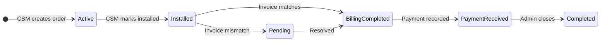
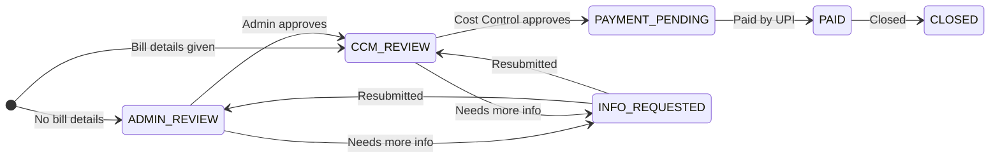
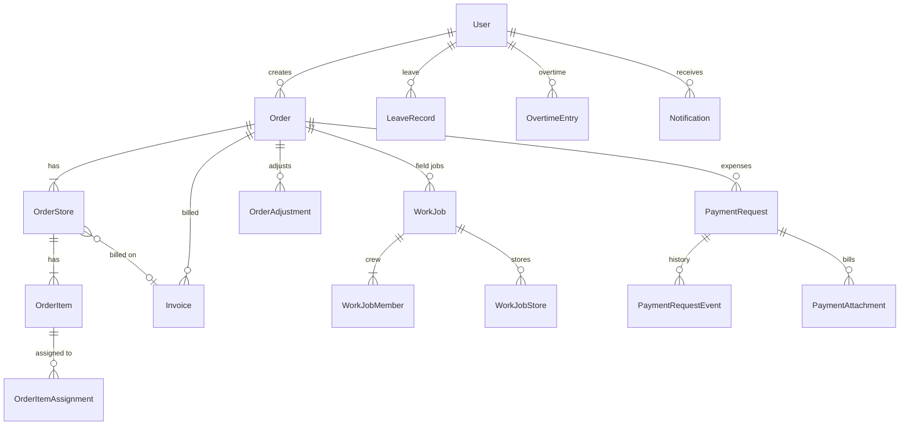

<p align="center">
  <picture>
    <source media="(prefers-color-scheme: dark)" srcset="apps/web/public/logo-dark.webp" />
    
  </picture>
</p>

<h1 align="center">Sai Balaji Digitals — Order Management System</h1>

<p align="center">
  Internal system for a signage and printing company. It follows every order from creation through
  production, field installation, billing and payment, and runs the field team's jobs, leave and
  expense payouts alongside it.
</p>

<p align="center">
  
  
  
  
  
  
  
</p>

---

## Contents

- [What it does](#what-it-does)
- [Roles and portals](#roles-and-portals)
- [Order lifecycle](#order-lifecycle)
- [Payment requests](#payment-requests)
- [Tech stack](#tech-stack)
- [Project structure](#project-structure)
- [Getting started](#getting-started)
- [Environment variables](#environment-variables)
- [Scripts](#scripts)
- [Testing](#testing)
- [Deployment](#deployment)
- [API overview](#api-overview)
- [Data model](#data-model)
- [Security](#security)
- [Further documentation](#further-documentation)

---

## What it does

| Area | Highlights |
|:-----|:-----------|
| **Orders** | Multi-store orders with line items, POs and invoices per store. Order numbers follow `ORD{YY}{NNNN}`. Excel import, Excel export and emailed exports. |
| **Production** | Line items are assigned to one or more production staff, either one at a time or a whole order in one save with team suggestions. Completion is tracked per assignment. |
| **Field work** | Jobs for pasters, helpers and drivers with dates, vehicles, areas and stores, and an `ASSIGNED → STARTED → COMPLETED` flow (or `HOLD` / `CANCELLED`). |
| **People** | Leave requests, overtime entries for Admin approval, and field-staff masters (CSM codes, areas, vehicles). |
| **Billing** | Invoice reconciliation with mismatch detection, payment recording, follow-up remarks, and line adjustments. |
| **Expense payouts** | Field staff and CSMs raise payment requests, which are paid by UPI ID or UPI mobile number, with bill attachments. |
| **Dashboards** | Every role has its own dashboard. Every number on it links to the list behind it, and an in-page guide explains each figure. |
| **Turn-around time** | Measured in working days (Sundays excluded). Stage aging badges, an overdue report and a loss report. |
| **Notifications** | In-app notifications, branded HTML email, and WhatsApp through AskEva. WhatsApp runs in log-only mode until switched to live. |
| **Audit** | Database triggers keep full before/after snapshots, and orders also keep a field-level change log. |
| **Theme** | Light and dark themes. The choice is remembered and applied before the page paints. |

---

## Roles and portals

| Role | Portal | What they do |
|:-----|:-------|:-------------|
| `ADMIN` | `/admin` | Everything: orders, the grid and board, jobs, field staff, leave, overtime, payments, reports, overdue and loss reports, audit log, masters, users, import, financial year, WhatsApp and settings. A super-admin can also manage users and run bulk imports. |
| `OPERATION_MANAGER` | `/admin` | The same screens, read-only. The API rejects every request that isn't a `GET`. |
| `CSM` | `/employee` | Creates and edits orders, uploads orders from Excel, marks installs, books field jobs and raises payment requests. |
| `ACCOUNTS` | `/accountant` | Billing queue, invoices, payments, follow-ups, reports and the financial year. |
| `PRODUCTION_MANAGER` | `/prod-manager` | Assigns line items to production staff and watches team workload. |
| `PRODUCTION` | `/production` | Works through their queue and marks items complete. |
| `COST_CONTROL_MANAGER` | `/cost-control` | Reviews, pays and closes payment requests. |
| `PASTER` · `HELPER` · `DRIVER` | `/field` | See their own jobs, apply for leave and raise payment requests. |

Every portal also has `/profile` and a notifications page.

---

## Order lifecycle



While an order is `Active`, the dashboards split it into pipeline stages:

| Stage | Meaning |
|:------|:--------|
| **Not assigned** | No production work has been given out yet. |
| **Production** | Items are assigned and some are still open. |
| **Installation** | Production is done and the order is waiting for the install. |
| **Billing** | The order is installed and waiting for an invoice. |
| **Payment** | The order is billed and waiting for payment. |

An Admin can force-close an order at any stage with a reason: Reprint, Sample, Under Warranty, Free of Cost, Revised, Extra/Less Amount or Other.

---

## Payment requests



The route is fixed when the request is submitted. A request can also end as `REJECTED` or `CANCELLED`. Each request refers to its order by the order number.

---

## Tech stack

| Layer | Technology |
|:------|:-----------|
| **Web** | React 19, Vite, TanStack Router and Query, Tailwind CSS 4, shadcn/ui (Radix), Recharts, React Hook Form with Zod, Sonner |
| **API** | Node.js, Express, Prisma, PostgreSQL, Zod, Helmet, express-rate-limit |
| **Auth** | JWT in an httpOnly cookie, bcrypt, role-based middleware |
| **Files** | Cloudflare R2 (S3-compatible, signed with `aws4fetch`) |
| **Messaging** | Brevo (email API), WhatsApp through AskEva |
| **Excel** | SheetJS (`xlsx`) |
| **Hosting** | Web on Cloudflare Workers with static assets; API on Render |
| **Monorepo** | npm workspaces: `apps/api`, `apps/web`, `packages/shared-types` |

---

## Project structure

```
.
├── apps/
│   ├── api/                       Express + Prisma backend
│   │   ├── prisma/
│   │   │   ├── schema.prisma      Database schema
│   │   │   ├── migrations/        SQL migrations (applied by hand in production)
│   │   │   ├── seed.ts            Office logins
│   │   │   └── seed-test-data.ts  Sample orders across every stage
│   │   ├── src/
│   │   │   ├── app.ts             Express app and route mounting
│   │   │   ├── server.ts          Entry point
│   │   │   ├── controllers/       Route handlers
│   │   │   ├── middlewares/       Auth, roles, read-only guard
│   │   │   ├── routes/            Route definitions
│   │   │   ├── services/          Email, WhatsApp, storage, notifications
│   │   │   └── utils/             Config, validators, working-day maths
│   │   └── tests/
│   │       ├── unit/              Pure-function tests
│   │       └── api/               HTTP tests against a test database
│   └── web/                       React frontend
│       ├── public/                Logos, favicons
│       └── src/
│           ├── api/               API client functions
│           ├── components/        UI, layout, dashboards, orders, payments
│           ├── lib/               Hooks, theme, helpers
│           └── routes/            File-based routes, one folder prefix per portal
├── packages/shared-types/         Types shared by web and API
├── worker/index.js                Cloudflare Worker: serves the web app, proxies /api
├── wrangler.json                  Cloudflare config
└── docs/                          Runbooks and analysis
```

---

## Getting started

**Requirements:** Node.js 18 or newer, npm 9 or newer, PostgreSQL 14 or newer.

```bash
# 1. Install
git clone https://github.com/im-notpranav/SaiBalajiDigitals.git
cd SaiBalajiDigitals
npm install

# 2. Configure the API
cp apps/api/.env.example apps/api/.env
#    then set DATABASE_URL and JWT_SECRET at least

# 3. Create the database and logins
cd apps/api
npx prisma migrate dev
npm run db:seed
npm run db:seed:allocation       # optional: field-staff masters
npx tsx prisma/seed-test-data.ts # optional: sample orders (remove with --cleanup)
cd ../..

# 4. Run web and API together
npm run dev
```

| Service | URL |
|:--------|:----|
| Web app | http://localhost:5173 |
| API | http://localhost:3001 |

In development, Vite proxies `/api` to the API, so the web app needs no environment variables.

---

## Environment variables

These go in `apps/api/.env`. See `apps/api/.env.example` for comments on each one.

| Variable | Required | Default | Purpose |
|:---------|:--------:|:--------|:--------|
| `DATABASE_URL` | Yes | — | PostgreSQL connection string |
| `JWT_SECRET` | Yes | — | At least 32 random characters. The server refuses to start without it. |
| `JWT_EXPIRES_IN` | | `7d` | Session length |
| `PORT` | | `3001` | API port |
| `NODE_ENV` | | `development` | `production` turns on secure cookies |
| `CLIENT_URL` | | `http://localhost:5173` | Allowed CORS origin(s) |
| `APP_URL` | | first `CLIENT_URL` | Public web address, used for "Open in app" links |
| `R2_ACCOUNT_ID` · `R2_ACCESS_KEY_ID` · `R2_SECRET_ACCESS_KEY` · `R2_BUCKET` | For uploads | — | Cloudflare R2 storage for photos and bill attachments |
| `BREVO_API_KEY` | | — | Email through Brevo. Leave empty to turn email off. |
| `EMAIL_FROM_ADDRESS` · `EMAIL_FROM_NAME` | | `noreply@saibalaji.com` · `Sai Balaji OMS` | Sender. The address must be verified in Brevo. |
| `ADMIN_EMAIL` | | — | Recipient of admin notifications |
| `WHATSAPP_MODE` | | `log` | `log` records messages without sending them; `live` sends them. |
| `ASKEVA_SEND_URL` · `ASKEVA_TOKEN` · `ASKEVA_WEBHOOK_SECRET` | For WhatsApp | — | AskEva sending and the delivery webhook |

The web app reads only `VITE_API_URL`, and only when the API is on a different origin.

---

## Scripts

| Where | Command | Does |
|:------|:--------|:-----|
| root | `npm run dev` | Runs the web app and the API together |
| root | `npm run build` | Builds every workspace |
| `apps/api` | `npm run typecheck` | Type-checks the API |
| `apps/api` | `npm test` | Runs the unit tests, then the API tests |
| `apps/api` | `npm run db:migrate` | Creates and applies a migration (development only) |
| `apps/api` | `npm run db:seed` | Seeds office logins |
| `apps/api` | `npm run import:field-staff` | Imports field staff from the old sheets |
| `apps/web` | `npm run lint` · `npm run format` | ESLint and Prettier |

---

## Testing

```bash
cd apps/api
npm run test:unit   # pure functions, no database
npm run test:api    # HTTP tests through the real app against a test database
```

The API tests cover orders, assignments, dashboards, payment requests, jobs, leave and permissions. They need a reachable PostgreSQL test database; see `vitest.api.config.ts`.

---

## Deployment

| Part | Host | How |
|:-----|:-----|:----|
| Web | Cloudflare Workers | `wrangler.json` serves `apps/web/dist` as a single-page app. `worker/index.js` proxies `/api/*` to `API_ORIGIN`. |
| API | Render | `npm run build`, then `node dist/server.js` in `apps/api` |
| Database | PostgreSQL | Migrations are **not** run on deploy |

**Apply migrations by hand before each release:**

```bash
cd apps/api
DATABASE_URL="<production url>" npx prisma migrate deploy
```

Back up production first. The full checklist is in [`docs/release-runbook.md`](docs/release-runbook.md): backup, migrations, Render variables, deploy, keeping the API awake, and WhatsApp go-live.

---

## API overview

All routes are under `/api` and need a signed-in user, except login and the webhooks.

| Prefix | Covers |
|:-------|:-------|
| `/auth` | Login (rate limited), logout, current user |
| `/orders` | Orders, stores, items, install, invoice, payment, close, force-close, flags, assignment (single and bulk), assignment suggestions, Excel export and import |
| `/dashboard` | One summary endpoint per role |
| `/admin` | Overdue report, audit, reports, settings and other Admin tools |
| `/users` | User management |
| `/clients` · `/media` · `/masters` | Lookups and field-staff masters |
| `/field-staff` · `/work-jobs` · `/csm-jobs` | Field staff and their jobs |
| `/leave` · `/overtime` | Leave requests and overtime approvals |
| `/payment-requests` | Expense payouts: create, review, pay, close, attachments, dashboard |
| `/my` | The signed-in user's own jobs, leave and requests |
| `/notifications` | In-app notifications |
| `/whatsapp` · `/webhooks` | WhatsApp templates and log; AskEva delivery reports |

Route files live in `apps/api/src/routes/`. Each one lists the roles allowed on each endpoint.

---

## Data model



Other models are `OrderChangeLog`, `AuditLog`, `PaymentFollowUp`, `OrderSequence`, `Client`, `Media`, `CsmCode`, `Area`, `Vehicle`, `EmailRecipient`, `WhatsAppMessage` and `AppSetting`. The source of truth is `apps/api/prisma/schema.prisma`.

---

## Security

| Concern | Measure |
|:--------|:--------|
| Sessions | JWT in an httpOnly cookie, `sameSite` strict, `secure` in production. The user's `is_active` and role are re-checked on every request. |
| Passwords | bcrypt hashes |
| Access | Role checks on every route. `OPERATION_MANAGER` is blocked from every write. |
| Abuse | Rate limits on all API traffic, login and emailed exports |
| Input | Zod validation on every write endpoint |
| Database | Prisma parameterised queries; audit triggers on key tables |
| Headers | Helmet (HSTS, frame and content-type protections) |
| Secrets | Environment variables only. The server won't boot without `JWT_SECRET`. |

---

## Further documentation

| File | Contents |
|:-----|:---------|
| [`docs/release-runbook.md`](docs/release-runbook.md) | Step-by-step production release |
| [`docs/analysis/`](docs/analysis) | Project analysis and gap review |
| [`ROADMAP_V2.md`](ROADMAP_V2.md) | Roadmap of the V2 build |
| [`AGENTS.md`](AGENTS.md) | Conventions for working in this repo |

---

**Private** — internal use by Sai Balaji Digitals only.
